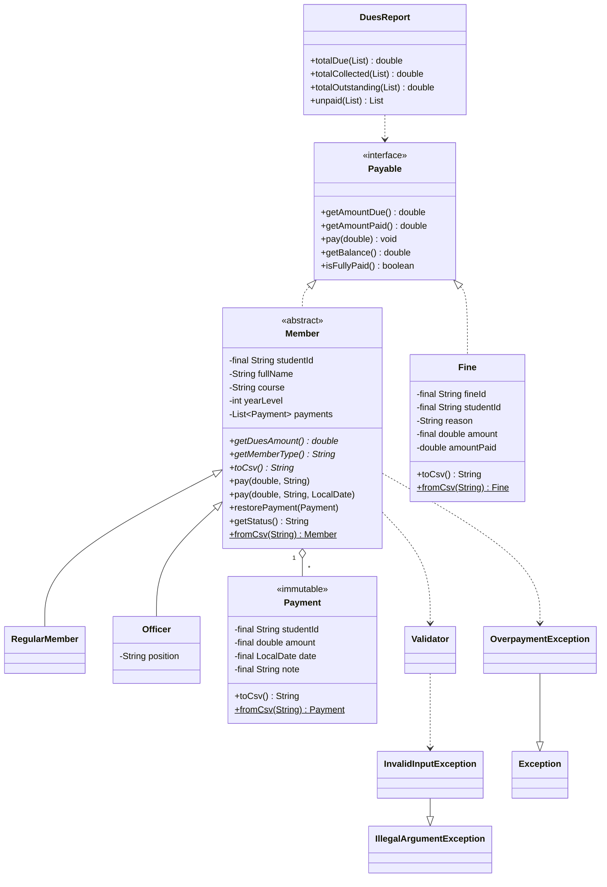

# Model Layer Handoff: Student Organization Dues Tracker

**From:** Model Developer  **To:** Storage and Exceptions Developer, GUI Developer, Documentation and Quality Lead
**Status:** Model is finished and passes `ModelTest` (all checks PASS). Compiles on JDK 21 with no warnings and no outside libraries.

The model knows nothing about windows or files. It only does the business rules. Please do not edit files in `src/model/` or `src/exceptions/` without telling me. One owner per file.

## 1. Class diagram



## 2. Where each requirement is met

| Requirement | Where |
| :--- | :--- |
| T1 Six or more classes | `Member`, `RegularMember`, `Officer`, `Fine`, `Payment`, `DuesReport`, `Validator` (model) plus two exceptions |
| T2 Encapsulation | All fields private. `studentId` (Member), `fineId`, `amount` (Fine), and all `Payment` fields are `final`. Setters call `Validator` |
| T3 Inheritance | `RegularMember` and `Officer` extend `Member` and call `super(...)` |
| T4 Polymorphism | `getDuesAmount()`, `getMemberType()`, `toCsv()` overridden (`@Override`). Overloaded `pay(...)` (3 versions) and `Officer(...)` (2 constructors). `ModelTest` section 1 loops over `List<Member>` |
| T5 Abstraction | `Member` is abstract with abstract methods. `Payable` is implemented by `Member` and `Fine` |
| T8 Custom exceptions | `OverpaymentException` (checked), `InvalidInputException` (unchecked) |
| T9 Validation | `Validator` rejects empty, wrong format, out-of-range, and negative values with friendly messages |

## 3. What each teammate needs to know

### Storage and Exceptions Developer

**CSV schema** (the model already provides `toCsv()` / `fromCsv()` for every record):

| File | Layout | Sample line (fake data) |
| :--- | :--- | :--- |
| `data/members.csv` | `TYPE,studentId,fullName,course,yearLevel[,position]` | `OFFICER,2023-0002,Ben Santos,BSCS,3,Treasurer` |
| `data/payments.csv` | `studentId,amount,date,note` | `2024-0001,150.00,2026-09-15,Cash` |
| `data/fines.csv` | `fineId,studentId,reason,amount,amountPaid` | `F-001,2024-0001,Missed general assembly,50.00,0.00` |

Sample files are already in `data/`.

**Loading** (inside your read loop, one `try/catch` per line so good lines still load, as T7 requires):
1. `Member.fromCsv(line)` for each line of `members.csv`.
2. `Payment.fromCsv(line)` for each line of `payments.csv`, then find the member by `getStudentId()` and call `member.restorePayment(payment)`. If no member has that ID, report the line as damaged.
3. `Fine.fromCsv(line)` for each line of `fines.csv`.
4. Catch `InvalidInputException` for every damaged line, keep its `getMessage()` in a "skipped lines" list, and report that list to the GUI.

**Saving:** write `member.toCsv()` for each member, then every `member.getPayments()` entry with `payment.toCsv()`, then `fine.toCsv()`.

**You still need to write:**
- `DuplicateIdException` (checked). Throw it from your store's `add(...)` when an ID already exists (also for fine IDs).
- `MemberNotFoundException` (checked), for lookups, payments, and deletes of an unknown ID.
- A `MemberStore` interface and `FileMemberStore` class (`add`, `findById`, `update`, `delete`, `search`, `getAll`, `load`, `save`). Keep the GUI depending on the interface type.
- Handle the first run with no file (start empty, do not crash).

Text fields cannot contain commas (the validator rejects them), so plain `split(",")` is safe for loading.

### GUI Developer

- Never put rules in the window. Convert text boxes with `Validator.parseInt("Year level", text)` and `Validator.parseAmount("Amount", text)`. They throw `InvalidInputException` whose `getMessage()` is ready to show in a `JOptionPane`.
- Catch two things around every action: `InvalidInputException` (bad input) and `OverpaymentException` (payment too big, message is ready to show).
- Create members with `new RegularMember(id, name, course, year)` or `new Officer(id, name, course, year, position)`. Show/hide the Position field depending on the type chosen.
- Useful getters for tables or lists: `getStudentId()`, `getFullName()`, `getCourse()`, `getYearLevel()`, `getMemberType()`, `getDuesAmount()`, `getAmountPaid()`, `getBalance()`, `getStatus()` (`PAID` / `PARTIAL` / `UNPAID`), `getPayments()`.
- Editing: `setFullName`, `setCourse`, `setYearLevel` (all validate). `Officer` also has `setPosition`. The student ID cannot change.
- Treasurer totals: `DuesReport.totalDue/totalCollected/totalOutstanding(list)` and `DuesReport.unpaid(list)` accept a `List<Member>`, a `List<Fine>`, or a `List<Payable>`.

### Documentation and Quality Lead

- Dues rules for the SRS: regular members pay PHP 200.00 per semester. Officers get a 50% discount (PHP 100.00). Overpayment is rejected. Payments cannot be dated in the future. Names, course, position, notes, and reasons cannot contain commas.
- Suggested exception use cases for the SRS: Record Payment (alternative flow: `OverpaymentException`), Add Member (alternative flows: invalid input, duplicate ID), Load Data (alternative flow: damaged line skipped and reported).
- The Mermaid diagram above can be redrawn in draw.io or StarUML for the formal UML.
- Each public class and method already has Javadoc. Please keep that standard for new code.

## 4. How to run the console test

From the project folder:

```
javac -d out src/exceptions/*.java src/model/*.java src/ModelTest.java
java -cp out ModelTest
```

Expected last line: `ALL CHECKS PASSED`.

## 5. Contribution log entry (copy into the README)

| Date | Member | What I did | Files or classes |
| :--- | :--- | :--- | :--- |
| Nov 19 | [Your name] | Wrote the member hierarchy, Payable interface, validation, payment and fine records, report totals, and the console test | Member, RegularMember, Officer, Payable, Fine, Payment, DuesReport, Validator, InvalidInputException, OverpaymentException, ModelTest |
